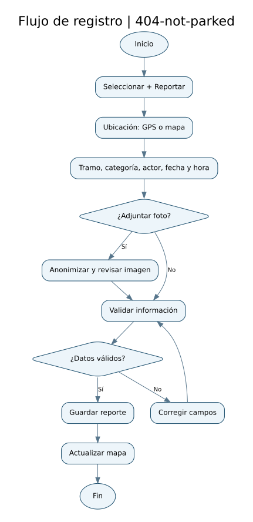

# Flujo de registro | 404-not-parked

Modelo lógico basado en la captura. Los roles son conceptuales; la autenticación y persistencia final no están verificadas. El flujo de anonimización es un requisito esperado.
