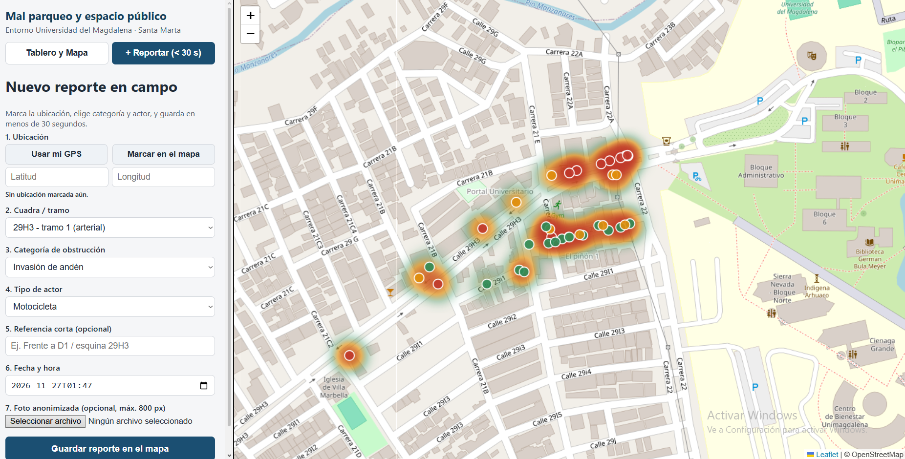

# Manual de usuario
1. Abrir la aplicación desde el navegador mediante el servidor local indicado por el equipo.
2. Seleccionar + Reportar.
3. Usar GPS (autorizar ubicación) o marcar en el mapa.
4. Verificar latitud y longitud; elegir cuadra o tramo.
5. Seleccionar categoría y tipo de actor.
6. Agregar referencia opcional y verificar fecha y hora.
7. Adjuntar, si se desea, una foto anonimizada (la interfaz indica máximo 800 px). Revisar que no aparezcan placas ni rostros identificables.
8. Presionar Guardar reporte en el mapa y comprobar el resultado.
9. Para consultar, seleccionar Tablero y Mapa; usar zoom y observar marcadores y mapa de calor.

## Problemas comunes
GPS: revisar permisos o marcar manualmente. Mapa: revisar conexión. Foto: comprobar formato y tamaño. Guardado: revisar campos y consultar al equipo si persiste el error.

No tomar fotografías mientras se conduce ni exponerse a conflictos.

